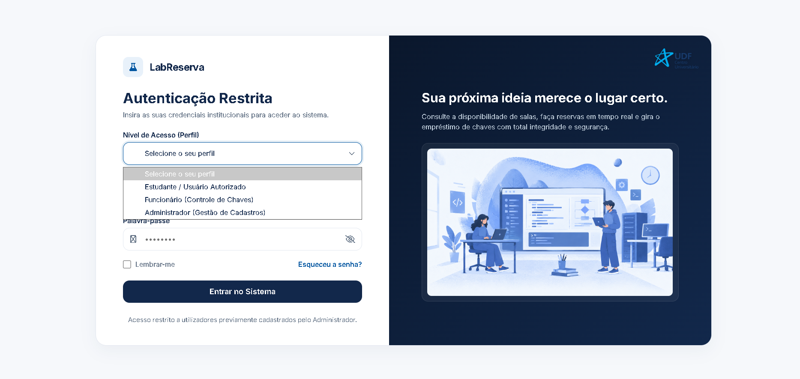
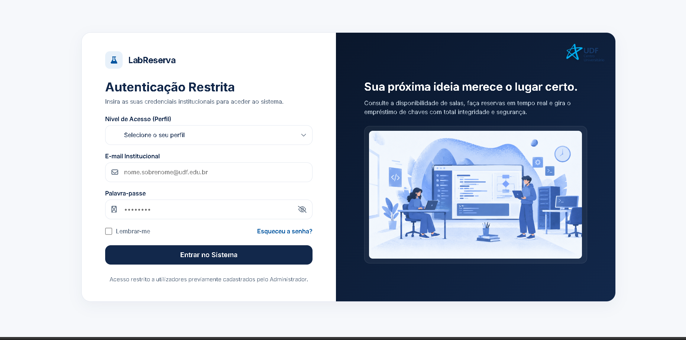

# 🔐 LabReserva — Tela de Autenticação (Login)

Este documento descreve a especificação, estrutura e implementação da **Tela de Login** do sistema **LabReserva**, desenvolvida para o **UDF Centro Universitário**.

---

## 📸 Demonstração da Interface

A interface foi projetada em duas colunas: a área de autenticação funcional à esquerda e o painel institucional com ilustração à direita.

| Visão Geral da Tela de Login | Seleção de Perfis de Acesso |
| :---: | :---: |
|  |  |

---

## 🎯 Requisitos de Negócio e Funcionalidades da Tela

De acordo com a documentação oficial de requisitos do sistema:

1. **Autenticação Restrita:**
   * O acesso ao sistema é restrito a utilizadores previamente cadastrados pelo Administrador.
   * Não existe auto-cadastro público na tela inicial.

2. **Níveis de Acesso (Perfis):**
   * **Estudante / Usuário Autorizado:** Acesso à consulta de horários e solicitações de reserva.
   * **Funcionário:** Acesso ao painel de controlo de retirada e devolução de chaves.
   * **Administrador:** Acesso completo à gestão de cadastros (usuários, salas, chaves e laboratórios).

3. **Campos do Formulário:**
   * **Seletor de Perfil:** Valida a permissão correspondente ao tipo de conta.
   * **E-mail Institucional:** Padrão `@udf.edu.br`.
   * **Palavra-passe:** Campo com funcionalidade para alternar visibilidade.
   * **Lembrar-me e Recuperação de Senha:** Links de suporte ao utilizador.

---

## 🎨 Padrões Visuais e Design System (UDF)

A interface segue rigorosamente o guia visual institucional do UDF:

* **Tipografia:** `Inter` (Google Fonts) em pesos 400, 500, 600 e 700.
* **Paleta de Cores:**
  * **Navy Primary / Deep:** `#12284B` / `#0A172C` (Fundo do painel direito e botões principais)
  * **UDF Blue:** `#0055A0` (Destaques e estados de foco)
  * **Page Background:** `#F6F8FB` (Fundo neutro claro)
  * **Mist Blue:** `#E8F1FA` (Ícones e badges)
* **Elementos Gráficos:**
  * Logótipo do UDF no canto superior direito do painel escuro.
  * Ilustração institucional do laboratório de código (`assets/laboratorio-codigo.png`).
  * Borda arredondada suave de `20px` no container principal com sombra elevada.

---

## 📁 Ficheiros da Tela de Login

```
labreserva/
├── assets/
│   ├── laboratorio-codigo.png
│   ├── udf-logo.webp
│   ├── Captura_de_tela_2026-10-24_202142.jpg
│   └── Captura_de_tela_2026-10-24_202234.jpg
├── login.html
└── login.css
```

---

## 🚀 Como Visualizar Localmente

1. Garanta que os ficheiros `login.html`, `login.css` e a pasta `assets/` estão na mesma diretoria.
2. Abra o ficheiro `login.html` num navegador web moderno (Chrome, Edge, Firefox, Safari) ou utilize a extensão **Live Server** no VS Code.
