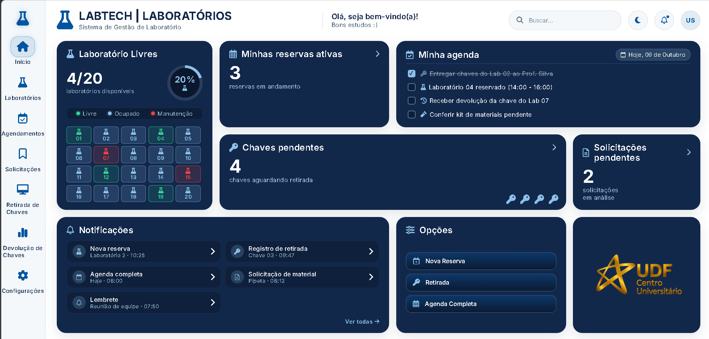
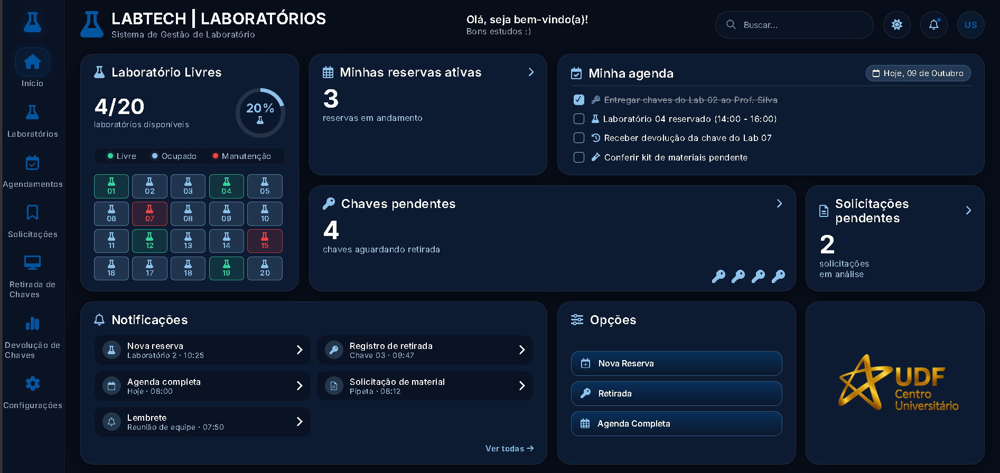

# LabTech — Sistema de Gestão de Laboratório

<div align="center">



*Plataforma corporativa e académica de alta performance desenvolvida para o controlo em tempo real de laboratórios, reservas de espaços e gestão de empréstimo de chaves do UDF.*

</div>

---

## 📋 Sobre o Projeto

O **LabTech** é um sistema moderno de gestão de laboratórios projetado para otimizar a rotina académica e administrativa do Centro Universitário (UDF). A aplicação oferece uma visão centralizada e intuitiva da disponibilidade dos espaços, controlo de agendas, acompanhamento de chaves e notificações em tempo real.

---

## 🎨 Identidade Visual & Design System

O projeto segue rigorosamente o guia visual corporativo institucional:
* **Tipografia:** Tipografia limpa e moderna **Inter** em todos os pesos, garantindo legibilidade e harmonia visual[cite: 7].
* **Paleta de Cores:** Fundo principal refinado em tons limpos, com cartões corporativos em azul-marinho profundo (`#12284B`) e acentuados com detalhes em azul claro (`#8CC1E9`).
* **Sem Mascotes:** Interface 100% profissional, focada em produtividade, utilidade e design corporativo limpo.

---

## 🌓 Modos de Visualização (Tema Claro & Escuro)

O sistema conta com suporte nativo a **Dark Mode** funcional com persistência de preferência via `localStorage`, proporcionando conforto visual em qualquer ambiente de trabalho.

### ☀️ Modo Claro (Light Mode)
O modo claro destaca a interface com fundos limpos, ideal para ambientes diurnos e escritórios iluminados.

<div align="center">
  
</div>

### 🌙 Modo Escuro (Dark Mode)
O modo escuro utiliza tons profundos adaptados (`#070d19` e `#0d1b32`) para reduzir o cansaço visual e otimizar o uso noturno.

<div align="center">
  
</div>

---

## 🚀 Funcionalidades Principais

* **🗺️ Mapa de Laboratórios em Tempo Real:** Monitorização interativa de 20 laboratórios com indicação de estados (*Livre*, *Ocupado* e *Manutenção*).
* **📅 Gestão de Agenda & To-Do:** Controlo diário de tarefas, entregas e horários reservados.
* **🔑 Controlo de Chaves & Solicitações:** Acompanhamento rápido de chaves pendentes de retirada e solicitações de materiais em análise.
* **🔔 Central de Notificações:** Alertas instantâneos integrados na barra superior para manter a equipa sincronizada.
* **🌙 Toggle de Tema Dinâmico:** Alternância instantânea entre modo claro e escuro diretamente na barra de navegação superior.

---

## 💻 Tecnologias Utilizadas

* **HTML5** (Marcação semântica e estruturada)
* **CSS3** (Variáveis nativas, Grid Layout, Flexbox e suporte a Dark Mode)
* **JavaScript Puro (Vanilla)** (Gestão de estados, interatividade e persistência no `localStorage`)
* **Font Awesome 6** (Biblioteca de ícones vetoriais)
* **Google Fonts (Inter)**

---

## ⚙️ Como Executar o Projeto

1. Clona este repositório para a tua máquina local:
   ```bash
   git clone [https://github.com/teu-utilizador/labtech.git](https://github.com/teu-utilizador/labtech.git)
